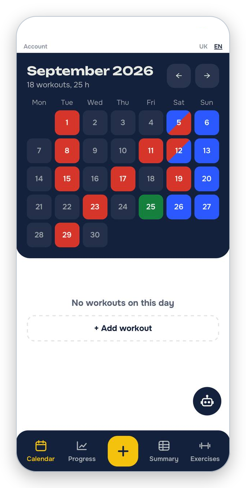
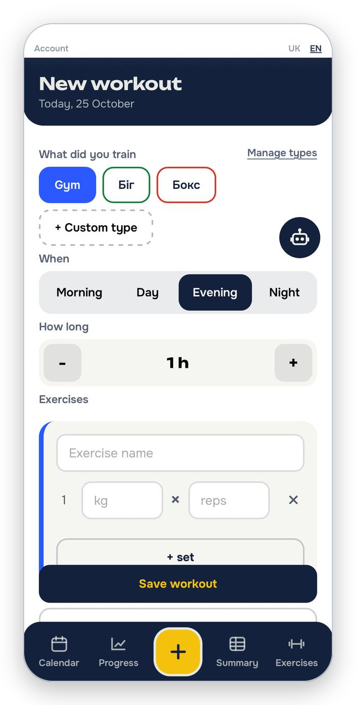
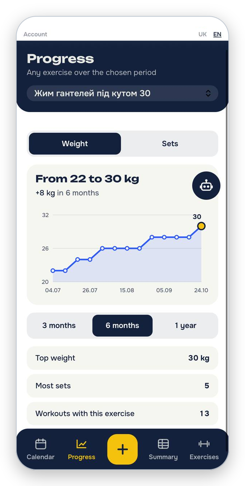
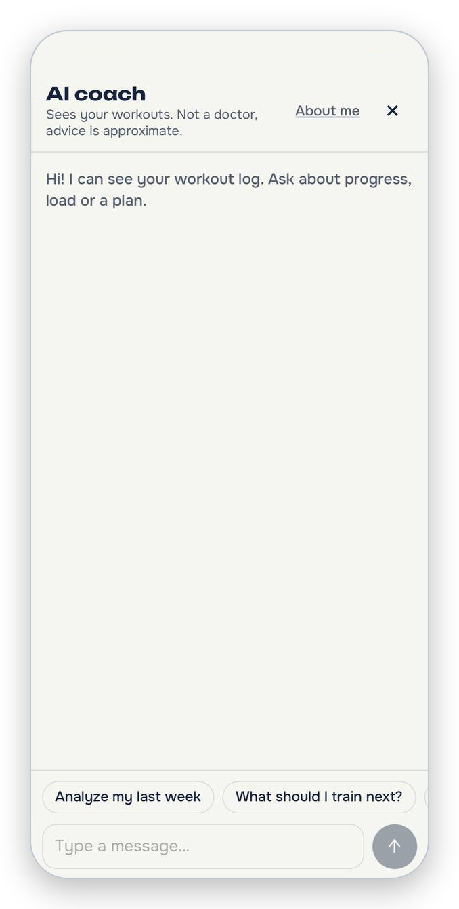

<div align="center">

# 🏋️ DayByFit

**A mobile-first workout tracker with an AI coach that knows your training history.**

[**Live demo →**](https://day-by-fit.vercel.app) · [Українська версія](README.uk.md)


> 🤖 **AI-assisted project.** Built as a portfolio piece by a junior frontend developer working _together with_ an AI assistant (Claude). See [How this was built](#-how-this-was-built-ai-assisted) for what that means in practice.

</div>

---

## 📸 Screenshots

<!--
  TODO: add screenshots to docs/screenshots/ and replace this block.
  Suggested set: calendar, add workout, progress, AI coach, summary, exercises.

<p align="center">
  
  
  
  
</p>
-->

_Screenshots coming soon._

---

## ✨ Features

**Training log**

- Calendar view with all workouts for the selected day
- Workout types: gym, boxing, running, and **custom types** (own name and colour; optionally with exercises)
- Gym workouts with exercises and sets (weight × reps), exercise-name suggestions from your history
- Time of day, duration and a free-text note on every workout
- **Edit and delete** workouts, **rename and delete** exercises, manage workout types

**Insights**

- Per-exercise progress over time
- Searchable list of all exercises with the latest top set
- Summary table with CSV export

**AI coach** 🤖

- Chat with a coach that sees your last 12 weeks of workouts, notes and progress per exercise
- **Streaming answers** (the reply appears gradually, like a real chat)
- **Long-term memory:** the coach keeps short notes about you (goals, injuries, preferences), updated in the background every few messages, and you can wipe them
- Remembers the conversation, with a "clear chat" action
- Per-user daily message limit to protect the shared free API quota
- Draggable chat button that snaps to the left or right edge of the screen

**Product details**

- Accounts with email and password; the app requires a login
- Data is stored in the cloud and private per user
- Ukrainian and English interface
- Installable as a **PWA** (home-screen icon, standalone mode, in-app "Install" button with an iOS hint)
- Mobile-first layout, keyboard-aware chat for iOS and Android, code-split pages

---

## 🧱 Tech stack

| Area                 | Tools                                                                      |
| -------------------- | -------------------------------------------------------------------------- |
| Frontend             | React, TypeScript, Vite, React Router, CSS Modules                         |
| i18n                 | i18next, react-i18next (uk / en, plural forms)                             |
| Backend              | Supabase: Auth, Postgres with Row Level Security, Edge Functions (Deno)    |
| AI                   | Groq API (OpenAI-compatible), `openai/gpt-oss-120b`, server-sent streaming |
| Rendering AI replies | react-markdown, remark-gfm                                                 |
| Hosting              | Vercel (frontend), Supabase (backend)                                      |

---

## 🏗️ Architecture highlights

- **`useSyncedList`**: one generic hook that powers workouts and workout types: loading, optimistic add / update / remove with **rollback on failure**, retry, and a per-user cloud cache that cannot leak between accounts.
- **Row Level Security** on every table: each user can only read and write their own rows.
- **The LLM key never reaches the browser.** The AI coach is a Supabase Edge Function: it verifies the user's JWT, applies the rate limit, builds the context from the user's data (through RLS), streams the model's answer back and saves the conversation.
- **Abuse protection:** the daily limit is counted from messages that only the server can write, so a client cannot reset it. Notes and workout text are passed to the model as data, with an explicit instruction to ignore instructions found inside them.
- **Memory** is a separate table that the function updates in the background (`waitUntil`), so replies are never slowed down by summarising.
- **Performance:** route-level code splitting with `React.lazy`; the heavy markdown renderer is only loaded with the chat.

---

## 🚀 Getting started

**Requirements:** Node.js 22+, a free [Supabase](https://supabase.com) project, a [Groq](https://console.groq.com) API key.

```bash
git clone https://github.com/RVasyliuk-2003/DayByFit.git
cd DayByFit
npm install
```

Create `.env.local` in the project root:

```env
VITE_SUPABASE_URL=https://YOUR_PROJECT_REF.supabase.co
VITE_SUPABASE_KEY=YOUR_PUBLISHABLE_KEY
```

Run the app:

```bash
npm run dev
```

### Database

The app uses these tables, each with RLS enabled and a `user_id` column that defaults to `auth.uid()`:

| Table            | Purpose                                                            |
| ---------------- | ------------------------------------------------------------------ |
| `workouts`       | workouts with exercises (JSON), note, time of day, duration        |
| `workout_types`  | custom workout types                                               |
| `coach_messages` | AI chat history (written by the Edge Function only)                |
| `coach_memory`   | long-term notes about the user (written by the Edge Function only) |

Full schema with Row Level Security policies: [`supabase/schema.sql`](supabase/schema.sql).

### AI coach (Edge Function)

```bash
npx supabase login
npx supabase link --project-ref YOUR_PROJECT_REF
npx supabase secrets set LLM_API_KEY=YOUR_GROQ_KEY
npx supabase functions deploy coach
```

Optional secrets: `LLM_BASE_URL` and `LLM_MODEL` to switch to another OpenAI-compatible provider or model.

---

## 🤖 How this was built (AI-assisted)

This project was created with the help of an AI assistant (**Claude**), and I want to be open about it, because _working effectively with AI is part of what this repository shows._

**What I did**

- Defined the product: features, user flows, what to build next and what to leave out
- Chose and directed the architecture (accounts, cloud sync, RLS, Edge Function for the coach)
- Reviewed every change, ran it on real devices and reported precise bugs back (iOS keyboard covering the input, white screen from a hooks-order error, content hidden under the navigation bar, and more)
- Set up and operated the real infrastructure myself: Supabase project, SQL and policies, secrets, Vercel deployment, git workflow
- Made the trade-off decisions (e.g. hide-vs-delete for chat history, forbidding deletion of workout types that are in use)

**What the AI did**

- Proposed approaches and trade-offs, wrote and refactored code under my direction, explained errors and security implications

**What I learned along the way:** React hooks rules in practice, optimistic UI with rollback, Supabase auth and Row Level Security, Edge Functions and streaming, i18n with plural forms, PWA basics, debugging mobile-specific problems, reading and fixing build and runtime errors.

> I treat AI as a fast, knowledgeable pair-programmer: it speeds me up, but I own the decisions, the review, the testing and the deployment.

---

## 🗺️ Roadmap

- [ ] Coach tone settings
- [ ] JSON backup of workout data
- [ ] Publishing to Google Play (TWA)
- [ ] Automated tests

---

## 👤 Author

**RVasyliuk-2003**: junior frontend developer, Wrocław, Poland
[GitHub](https://github.com/RVasyliuk-2003) · [Live demo](https://day-by-fit.vercel.app)
